# 疯狂水世界 · 海岸打捞站

> 海风、旧船，还有捞不完的好东西。

一款 **海平面上涨之后、阳光海岸边** 的打捞经营小游戏。你守着一座会漂的小小避难所，轮流进入十一个小游戏捞回 **沉船藏品**；藏品可分解成仓库物资，再把打捞币和材料变成新的船壳、仓库和生活设备——偶尔，还能从沉船里捞出一台 **海水过滤器**。

**没有离线收益，没有体力，没有角色扮演。** 每一颗螺丝都要亲自去捞。

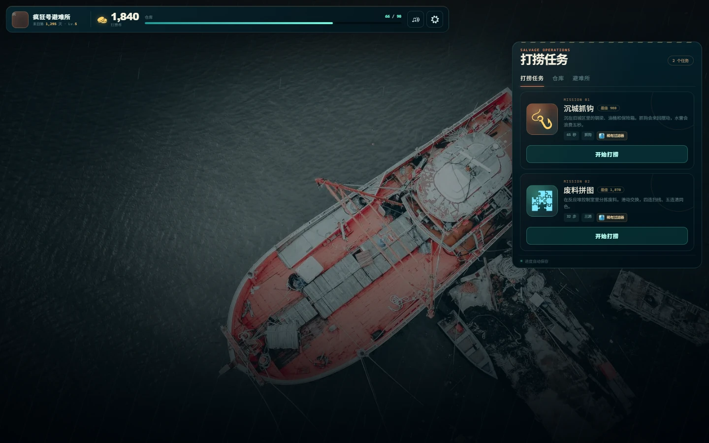

## 立即开玩

在线游玩：

**https://yhsome.github.io/crazy-water-world/**

源码仓库：**https://github.com/YHSome/crazy-water-world**

本地运行：

```text
直接双击 index.html 即可。
```

- 纯 **HTML + CSS + 原生 JavaScript**，无 Node、无 npm、无打包、无构建步骤。
- 不需要安装任何运行时，也不需要启动服务器；双击 `index.html` 即可。
- 图片、音频、脚本全部为本地文件，无远程运行时依赖。

> 手机、平板、桌面浏览器均可直接游玩。建议开启声音。

## 核心循环

```text
选择打捞任务
   ↓
沉城抓钩 / 废料拼图 / 声呐扫掠 / 沉船切割 / 分拣传送带 / 灯塔信号
   ↓
获得通用货币「打捞币」 + 1–2 件沉船藏品，并推进「打捞契约」
   ↓
存货进避难所仓库（容量有限，溢出会折算）
   ↓
领取契约奖励，扩建仓库 / 打捞工坊 / 声呐阵列 / 聚变核心
   ↓
更高收益、更长任务、更大仓库
```

**没有离线收益。** 页面关闭后，避难所不会自己变富，物资也不会自己变多；这里只有你亲手打捞回来的东西。

## 指挥台布局

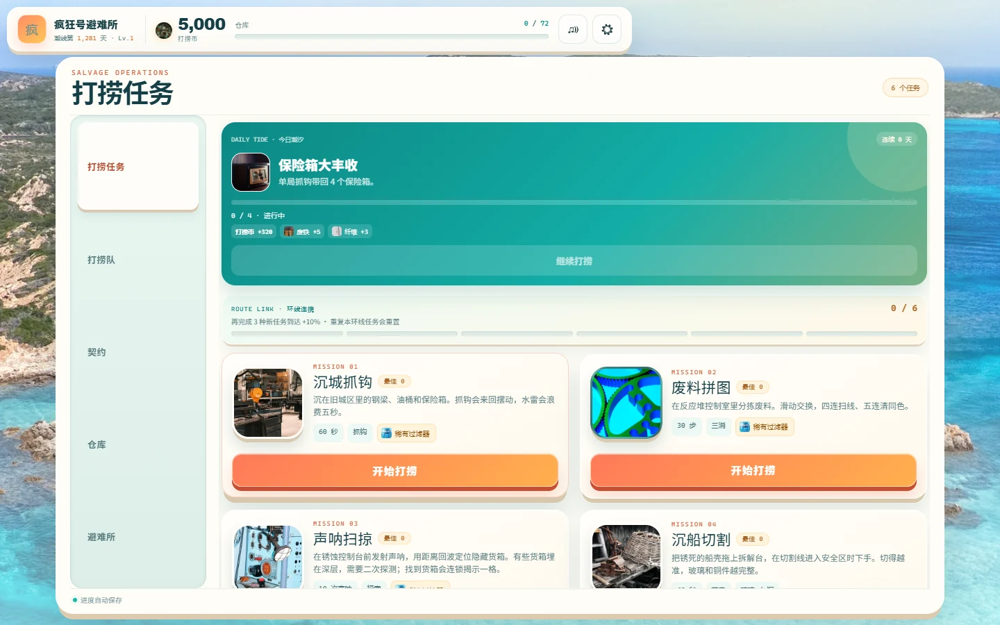

- 桌面：左侧五项导航 + 右侧多列内容网格，不再使用单一面板。
- 手机：顶部 HUD + 可滚动主内容 + 底部五项导航，取消上拉抽屉。
- 打捞任务 1–2 列，材料 / 收藏 / 集市 1–3 列，船员 1–3 列，随宽度重排。
- 新增「打捞队」导航，与任务、契约、仓库、避难所并列。


## 每日潮汐契约

任务页最上方是 **CORE SALVAGE · 核心打捞区**：

- 直接展示 3 个可玩小游戏；
- 第一张任务卡有金色描边；
- 点「开始打捞」立即进入简报；
- 日常、连携与追踪统一下移到「今日事务」区；主线剧情在避难所航海日志中。

### 今日推荐打捞

每天会从 3 个主动任务中选 1 个作为推荐：

- 该任务打捞币 **+20%**；
- 当天首次完成额外 **+1 件收藏**；
- 核心区顶部显示「DAILY PICK · 今日推荐」横幅；
- 对应任务卡有金色描边与「今日推荐 +20%」标签；
- 完成后横幅改为「首胜收藏已领取」，但 +20% 仍生效；
- 按本地日期刷新，同一天刷新页面不变。

### 任务熟练度

每个任务独立累计完成次数：

- 每 5 次升 1 级，最高 Lv.5；
- 每级该任务打捞币 **+3%**；
- 满级 **+15%**；
- 任务卡显示熟练等级、当前次数和进度条；
- 与今日推荐、海况、许可、环线加成叠乘；
- 旧存档从 Lv.0 开始，不产生离线收益。

### 海况图鉴

任务结算会读取本局海况：

- 6 种海况：静水 / 雷区 / 富氧 / 油污 / 赤潮 / 顺风；
- 双重海况会同时记录两种；
- 首次记录每种海况 +120 打捞币；
- 每种已记录海况永久提供 **+1% 打捞币**；
- 任务页显示已记录数量与彩色词条；
- 点击「查看」打开完整图鉴说明；
- 满图鉴提供 **+6%**，不产生离线收益。

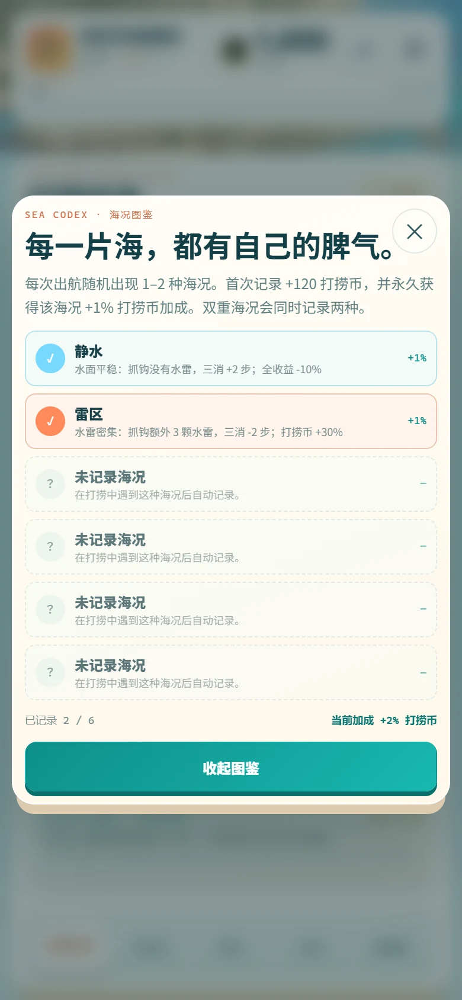

## 潮汐漂流瓶

任务页每天会出现一只漂流瓶：

- 打开后是一段短剧情；
- 三个选择：
  1. **打开瓶塞**：随机收藏 ×1 +100 打捞币；
  2. **交给阿盐**：320 打捞币 + 燃料 3 + 玻璃 3；
  3. **只读信纸**：随机收藏 ×2，不取打捞币。
- 选择后立即结算；
- 不选可以关闭，瓶子保留到做出选择；
- 当天处理完后显示「今天的信已经读完了」；
- 跨日重置，不产生离线收益。

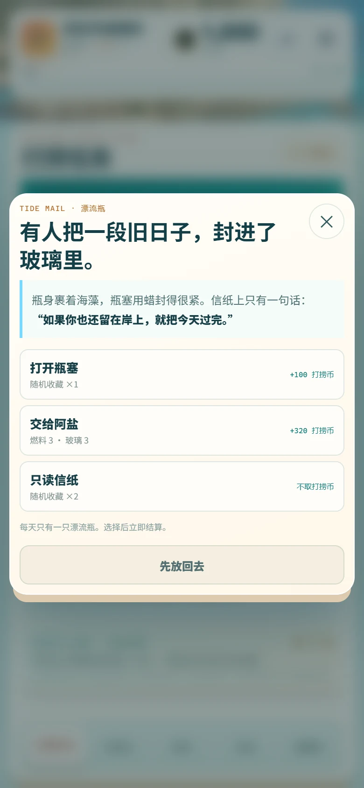

核心区下方每天会出现一张「今日潮汐」卡：

- 按日期固定生成 **3 个不重复目标**，同一天刷新页面不会变，跨日自动换新。
- 目标覆盖：抓钩保险箱 / 连击、三消分数、声呐找齐 4 个货箱、切割 4 个切口、分拣 8 件、灯塔复现 2 组、完成 3 局、带回 2 件收藏。
- 每项独立领取打捞币与材料；三项全清额外获得 **240 打捞币 + 废铁 4 + 纤维 4 + 芯片 2**。
- 当天第一次领取推进连签天数，最高 **+120 打捞币** 加成；同一天多单不重复加天数。
- 每项每天只能领取一次；进度只由实际打捞结算推进，不产生离线收益。
- 任务标签会出现可领取圆点，不会额外增加独立页面。

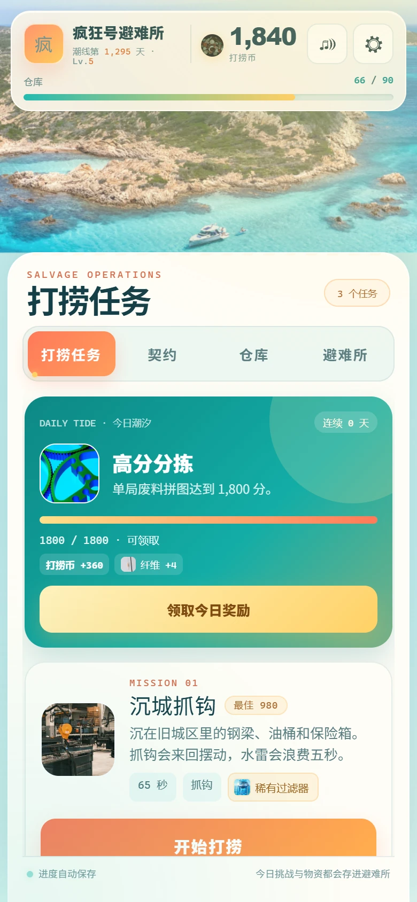

## 航海日志 · 长期成就

- 避难所页内切换「扩建 / 航海日志」，保持在现有导航内。
- 25 个里程碑：包含首次下潜、十次出航、九层连击、单局 2,500 分、声呐全图、3 台过滤器、10 件收藏、7 天连签、20 个保险箱、设施总等级 10，切割 / 分拣 / 灯塔 / 拖网 / 潜航 / 吊装首次完成、「十一面手」、第一枚 S / 十一项全能 S，船员 Lv.5 / 核心全员 Lv.5，以及避难所 Lv.5、工具 Lv.3、远征 1/10 次、急单 10 笔、六套奖励、完整 102 件档案。
- 自动记录最高连击、声呐全图次数、累计过滤器 / 收藏 / 保险箱 / 打捞币、三种新任务完成次数、最佳评级、船员熟练度、远征次数与急单笔数。
- 每个成就只能领取一次打捞币与材料；旧存档会按当前进度补全，可直接领取已达成的里程碑。
- 有可领取主线或成就时，避难所标签显示圆点。

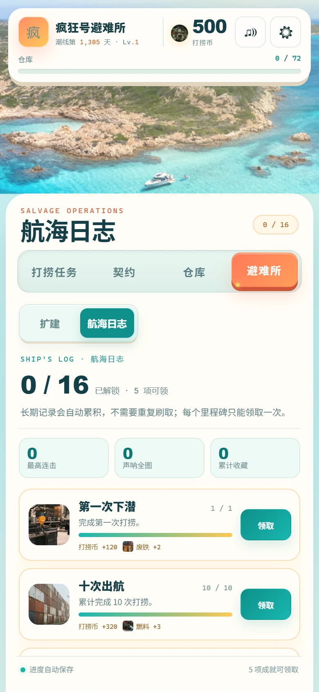

## 宣传片

30 秒 Canvas 宣传片：

- 1920×1080 / 24fps；
- 强调「完全由 AI 独立制作」「每 2 小时迭代一次」「不是游戏，是一场实验」；
- 六幕：实验开场 → AI 制作 → 10 种打捞 → 版本迭代 → 实验宣言 → 下一船。

在线播放：`promo/`  
成片文件：`promo/crazy-water-world-promo.mp4` / `.webm`

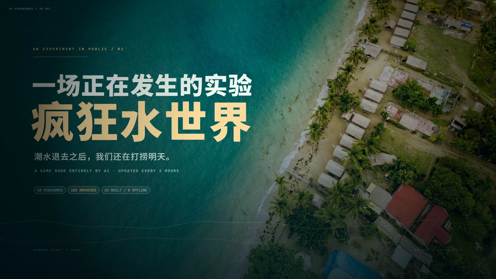

## 剧情新手引导

新存档第一次进入避难所时播放序章：

1. 阿盐在第三层甲板的缆绳堆里找到你。
2. 她介绍疯狂号与「用藏品换生存」的规矩。
3. 第一课是沉城抓钩。
4. 解释「全部打捞点都在轮换池中」，并建议先从沉城抓钩开始。

随后进入三步引导：

- 任务页高亮第一张打捞任务；
- 简报页高亮「开始打捞」；
- 第一局结算后引导打开收藏页。

最后引导去避难所扩建，完成奖励 **300 打捞币 + 废铁 3 + 纤维 3**。

- 可随时「跳过引导」，跳过不发奖励。
- 旧存档自动视为已完成，不强制播放。
- 进度写入 `tutorialStep`，刷新后继续当前步骤。
- 不产生离线收益。

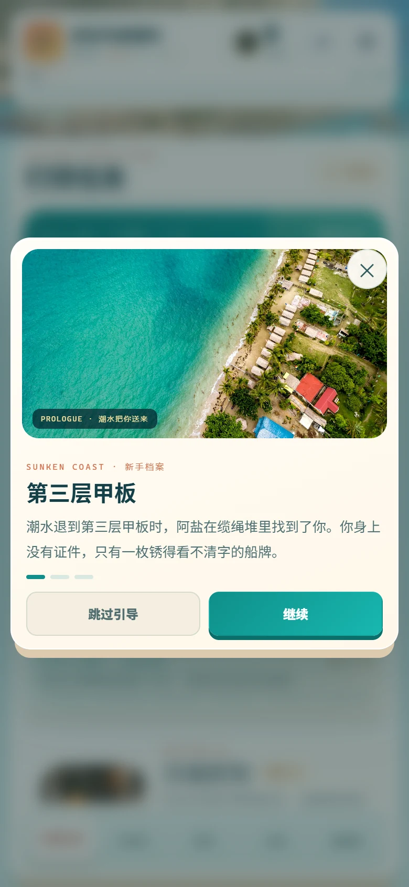

## 全部打捞点开放

新存档 Lv.1 就可以体验全部 **11 个打捞点**：

- 核心区显示 3 个主动任务；
- 其余 8 个留在后台候补轮换；
- 全部 11 个打捞点都在轮换池中，完成一局自动换入新的玩法；
- 不再需要升级避难所来解锁小游戏。

等级只影响外围系统：

| 避难所等级 | 开放系统 |
| --- | --- |
| Lv.1 | 打捞任务、仓库、避难所 |
| Lv.2 | 每日潮汐、熟练度、今日推荐、契约标签 |
| Lv.3 | 海况图鉴、漂流瓶、打捞队、航海日志 |
| Lv.4 | 本周航线、藏品追踪 |
| Lv.5 | 全部长期系统 |

- Lv.1 仍隐藏每日、海况、漂流瓶、熟练度、推荐、连携与追踪，降低首屏信息量。
- 顶部 `?` 可随时打开完整玩法说明。
- 升级提示只说明新增的外围系统。

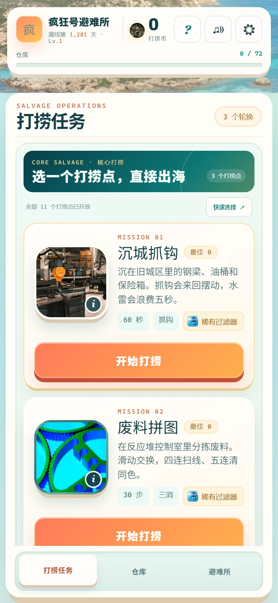

## 主线航海日志

新手引导结束后，主线剧情统一放在「避难所 → 航海日志」中；打捞任务页不再重复放置第二份日志：

| 章节 | 解锁条件 | 剧情 |
| --- | --- | --- |
| 第一章 · 锈船牌 | 完成 1 次打捞 | 船牌上的盐壳裂开，露出「疯狂」两个字 |
| 第二章 · 十件旧物 | 发现 10 件不同收藏 | 阿盐说，这些旧物是别人没来得及带走的生活 |
| 第三章 · 第三层甲板 | 避难所 Lv.3 | 疯狂号第一次像家，阿盐交给你一盏灯 |

- 每章 3 段剧情，目标完成后卡上出现「领取」按钮。
- 点击「领取」会先结算打捞币与材料，再自动打开该章剧情。
- 已领取章节的图片右上角出现详情图标 `i`，点击图片或图标即可回看剧情。
- 三章以任务列同时展示，每章都有独立图片、名称、进度和状态。
- 章节必须按顺序领取；未解锁章节显示「先完成上一章」。
- 全部读完后顶部显示 `3 / 3 章`，卡片保留回看入口。
- 不产生离线收益。

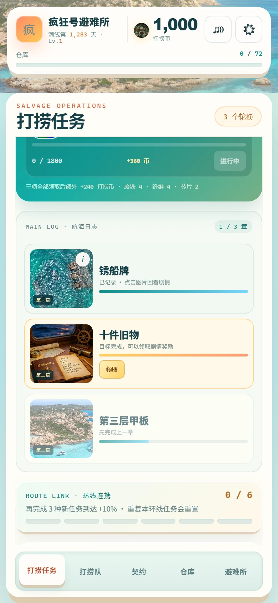

## 可领取奖励提示

所有可领取奖励按钮统一高亮：

- 金色脉冲外发光；
- 按钮扫光；
- 右上角红色 `!` 角标；
- 对应标签页显示可领取圆点。

覆盖每日潮汐、打捞契约、航海日志、成就、船员收获、收藏里程碑、套装奖励与剧情弹窗领取。

仓库标签在收藏里程碑或套装奖励可领时也会亮起红点。减少动态模式下会自动关闭脉冲与扫光。

## 十一个小游戏

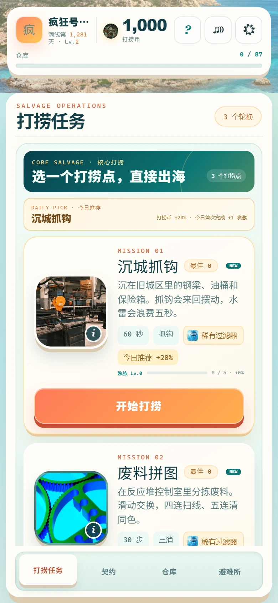

### MISSION 01 · 沉城抓钩

经典黄金矿工式玩法。抓钩在沉没城区的废墟上方来回摆动，点击水面放下抓钩：

- 抓回废钢、燃料桶、纤维捆、芯片箱、玻璃瓶、铜线圈、保险箱、金条、沉船秘宝和黄金宝箱。
- **物品分级**：低阶、进阶、高阶使用不同颜色的粗描边，高阶物品带 `★` 和大号名称标签，便于辨认。
- 高阶物品出现率已提高：保险箱、金条、沉船秘宝、黄金宝箱合计约占场上物品的三分之一。
- **精准投放**：抓钩摆到中心附近时放下，本次收获 +20%；偏离中心但仍在小范围内 +10%。
- **精准三连**：连续 3 次精准投放，额外 +120 打捞币。
- 对准中心时抓钩绳索变金色，并显示中心虚线。
- **幸运暴击**：15% 概率本次打捞币 ×2。
- **连击奖励**：4 连额外 +80、7 连额外 +180。
- **深海馈赠**：连续 4 次低阶收获后，场上一个低阶物品会升级为黄金宝箱。
- 沉船秘宝 / 黄金宝箱有概率带出稀有升级件。
- 水雷会炸掉 **5 秒**，并清空当前连击。
- 连续抓取会累积 **连击**：每层给本次打捞币 +8%，最高 9 层；6 秒内没有新收获会断连。

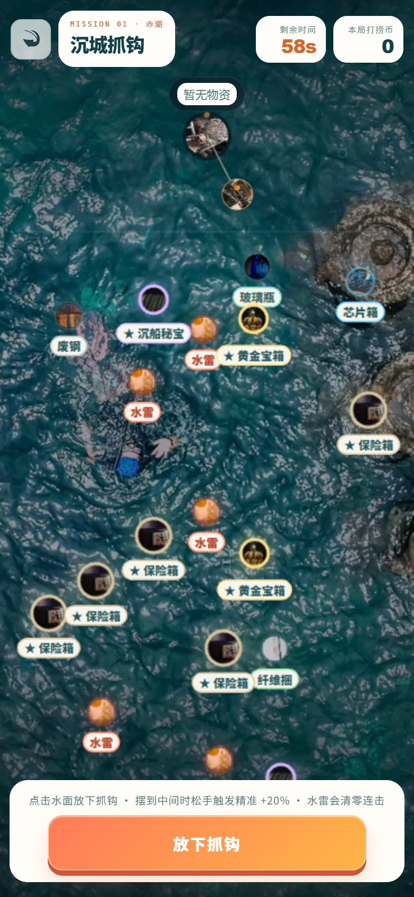
- 任务时长 60 秒，聚变核心每级 +5 秒。

### MISSION 02 · 废料拼图

7×8（横屏为 9×6）的三消分拣台：

- **滑动**相邻废料箱直接交换，也可以依次点选两格；三个或更多同类连成一线即可消除。
- 方块现在有**大号汉字标记**（铁/油/纤/芯/玻/铜/医/藏）+ 粗色边框，照片只作为底图，远近都能分辨。
- **四连**会扫掉整行或整列，并触发线扫光束；**五连**会清除全场同色废料，触发彩虹环和屏幕闪光。
- **深海馈赠**：每 4 次消除必定获得 1 件收藏，并有 18% 概率附赠稀有升级件；不再依赖极难凑齐的收藏方块。
- **连锁奖励**：4/6/8 连锁额外 +30 / +60 / +100 打捞币。
- 单局 1,200 / 2,400 分额外获得收藏；2,400 分起必定获得 1 件稀有升级件。
- 30 步内尽量多消除，聚变核心每级 +2 步。
- 六类材料按消除数量折算，医疗包会额外折算打捞币。

### MISSION 03 · 声呐扫掠

6×6 的沉没控制台声呐板：

- 4 个货箱藏在 36 格里；点击格子发射声呐，消耗 1 次探测。
- 空格会显示**离最近货箱的曼哈顿距离**；数字越小越接近。
- 找到保险箱、燃料桶、芯片箱、金条或收藏品后立刻结算；找到全部 4 个有额外奖励。
- **深层货箱**：约 55% 的航次有 1 个货箱埋在深层；第一次探测只显示「深」，需要对同一格再探一次才能回收。
- **连锁回波**：每找回一个货箱，会免费揭示一个相邻空格的距离，帮助继续推理。
- 每次出发有 **8%** 概率有一个货箱是海水过滤器；8 局保底同样适用。
- 声呐次数有限，先用回波建立热区，再收网。

### MISSION 04 · 沉船切割

拆解台节奏玩法：

- 橙色切割线沿轨道来回移动，点击时让它落在绿色安全区内。
- 每完成一个切口，安全区会变窄、速度会变快；失误扣 3 秒。
- 安全区中央有金色完美窄带：命中得 160 分，普通命中得 100 分，并额外 +1 秒。
- 完成 **6 个切口** 即可结束，切口越多，玻璃和铜件越完整。

### MISSION 05 · 分拣传送带

码头反应玩法：

- 中央传送带送来一件货物，底部有 4 个材料箱。
- 点选对应材料箱，把 12 件货物全部分拣完。
- 正确分拣累积连击，连击越高单次得分越高；点错清零。
- 连击达到 5 的倍数时额外 +2 秒。
- 点错扣 3 秒；六类材料都可能出现在传送带上。

### MISSION 06 · 灯塔信号

四灯记忆玩法：

- 四座信号灯按随机顺序闪烁，记住后按相同顺序点击。
- 每复现一轮，序列变长；共 3 组信号。
- **双灯同闪**：第 2、3 组会出现两座灯同时亮起，两灯可任意先后点击。
- 看错扣 5 秒并重放当前序列，适合喜欢记节奏的玩家。

### MISSION 07 · 潮汐拖网

接落物的拖网玩法：

- 点击或拖动水面，移动底部的渔网。
- 接住银鱼、漂流货箱、黄金鱼与深海珍珠；珍珠会带出随机收藏。
- 锈雷会扣 **4 秒** 并清空连收。
- **拖网道具**：
  - **磁力网**：6 秒内把下落物向渔网牵引；
  - **缓流符**：6 秒内降低下落速度；
  - **护网盾**：免疫一次锈雷。
- **完美接取**：海货落在渔网中心区域时，本次打捞币 ×1.25。
- **满网**：连续 3 次完美接取，5 秒内网面扩大 30%，海货收益再 ×1.2。
- 网下 3 个圆点显示完美充能；满网期间显示剩余秒数。
- 连续接住提高连收倍率，最高 9 层；单局 45 秒。
- 适合手速与走位，不需要额外体力。
- 所有下落物都带实体图片与汉字角标，不再只显示文字。

### MISSION 08 · 深海潜航

自由潜航玩法：

- 点击 / 拖动水域，控制潜水员在沉船断面间移动。
- 收集玻璃瓶、铜罗盘、芯片箱、金条与沉船遗物。
- 漂浮水雷会扣 4 秒；遗物会带出随机收藏。
- 随机道具：
  - **氧气瓶**：+10 秒；
  - **潜航护盾**：免疫一次水雷；
  - **磁力钩**：6 秒吸附周围漂浮物。
- **低氧冲刺**：最后 10 秒所有普通物资打捞币 ×1.3，屏幕出现红色低氧暗角。
- 低氧收集次数单独统计，并显示在结算标签。
- 单局 45 秒，连收最高 9 层。

### MISSION 09 · 码头吊装

吊装堆叠玩法：

- 吊臂带着货箱左右摆动，点击放下。
- 对准栈桥或已有货箱即可码稳；偏太多会掉进海里并扣 4 秒。
- 六只货箱全部卸完结束；每只货箱都有独立照片与名称。
- **完美连击**：与下一只货箱偏差不超过 10px 继续累积，每次提高奖励；普通落箱或落海会中断。
- 保险箱、金条箱、芯片箱提供更高打捞币。
- **黄金货箱**：连续 3 次完美落位后，下一只货箱变为黄金，收益 ×2 并额外 +1 秒。

### MISSION 10 · 黄金炮击

船首炮击玩法：

- 点击海面瞄准，黄金大炮向目标开炮。
- 击落漂流货箱、芯片箱、金条箱与沉船遗物。
- 水雷扣 3 秒；漏掉普通目标扣 2 秒。
- **散射炮**：每命中 5 次自动装填，下一发同时射出 3 枚炮弹。
- 散射炮就绪时炮身出现金色脉冲环与提示，命中后重新累计。
- 单局 45 秒，连击最高 9 层。
- 遗物目标会直接带出随机收藏。

### MISSION 11 · 海沟回声

洞穴闪避玩法：

- 拖动或点击控制潜航器左右移动。
- 下压岩层中间有缺口，穿过缺口继续前进。
- 每穿过一道岩层 +22 打捞币。
- 收集回声浮标、氧气瓶与沉船遗物；氧气 +3 秒。
- 每下潜 10 秒进入下一层，共 5 层；每层奖励 +100 打捞币。
- 12 秒后出现电鳗：黄色虚线预警，随后整列放电；站在电鳗列里会扣船体。
- 撞上岩层扣 4 秒和 1 点船体；3 点船体耗尽提前结束。
- 单局 50 秒。

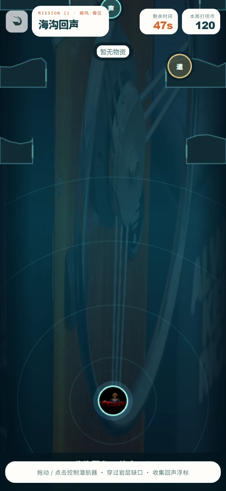

| 沉城抓钩 | 废料拼图 | 声呐扫掠 |
| --- | --- | --- |
| 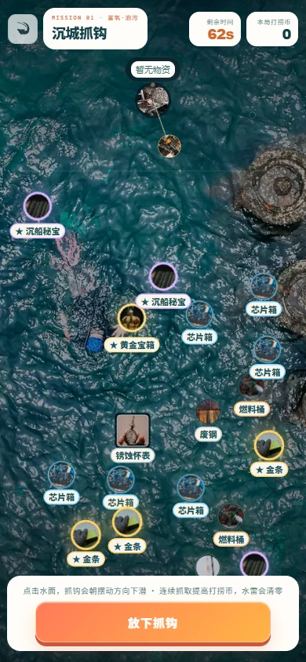 | 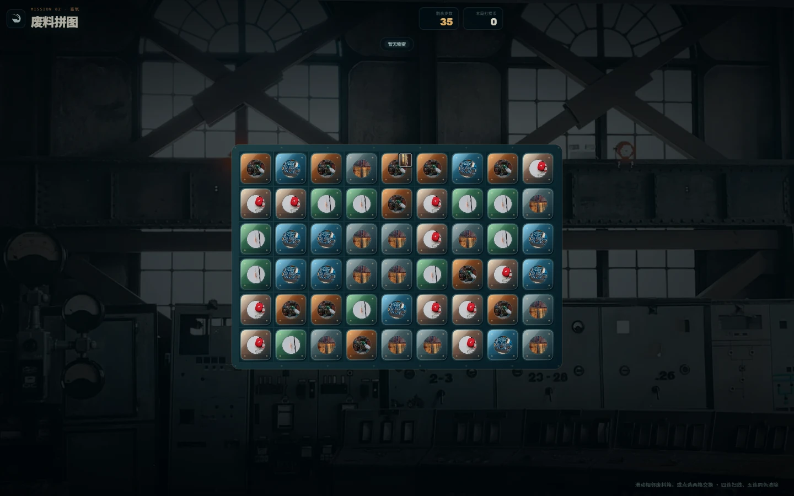 | 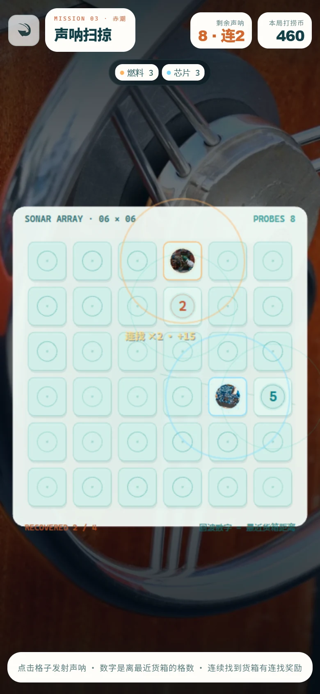 |

| 沉船切割 | 分拣传送带 | 灯塔信号 |
| --- | --- | --- |
| 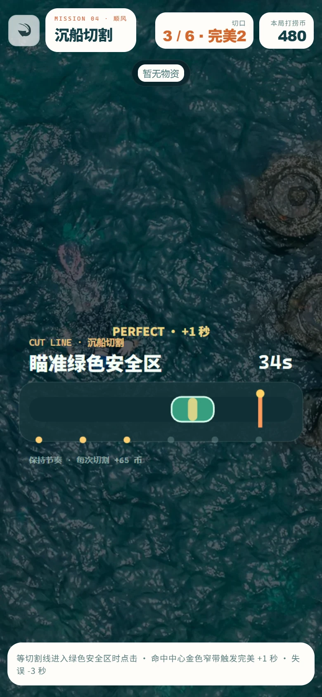 | 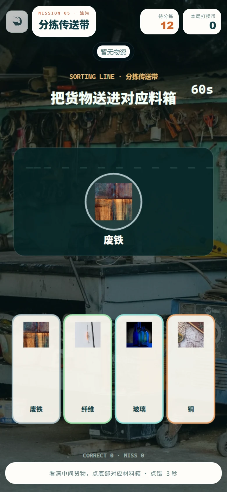 | 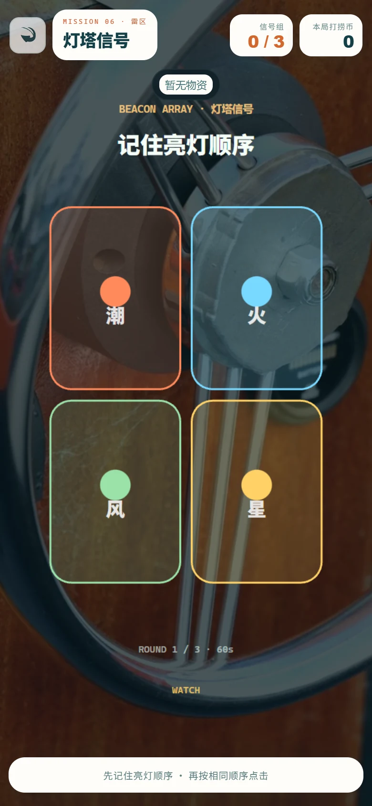 |

| 潮汐拖网 | 深海潜航 | 码头吊装 | 黄金炮击 |
| --- | --- | --- | --- |
| 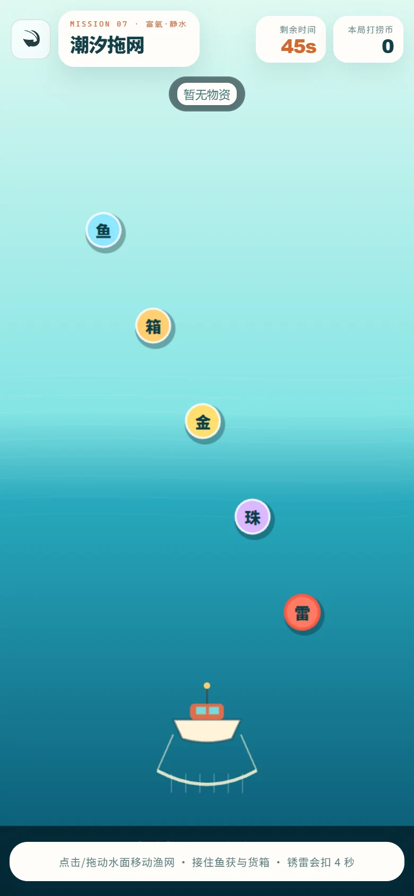 | 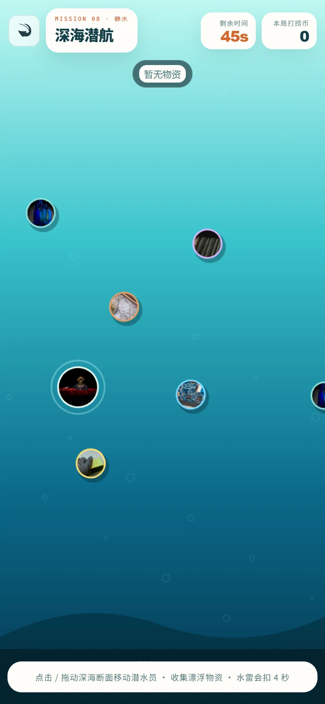 | 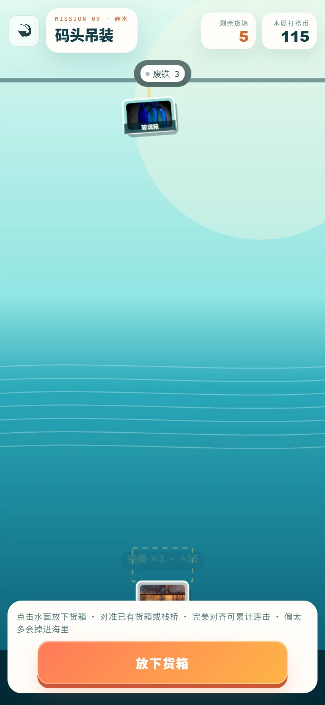 | 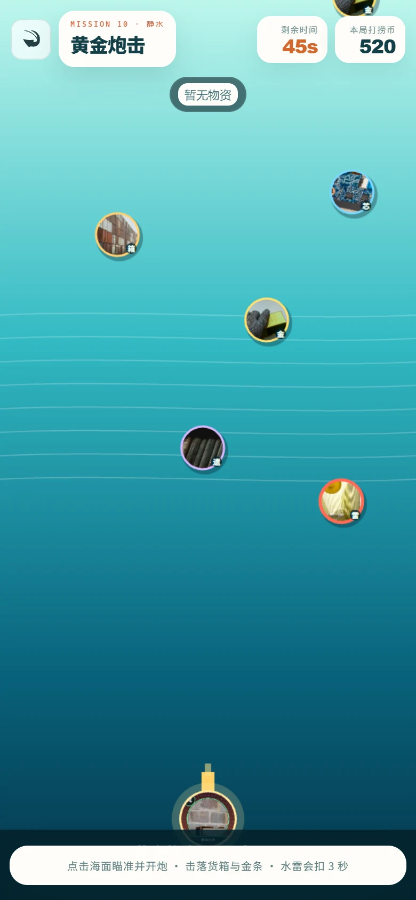 |

| 标题画面 | 手机竖屏 |
| --- | --- |
| 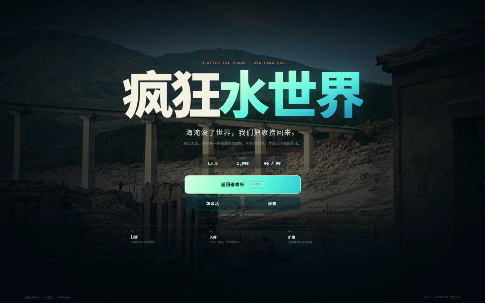 | 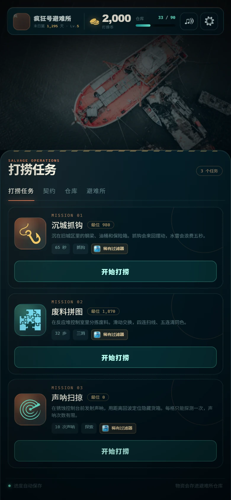 |

## 图片详情按钮

- 任务卡图片右下角有 `i` 详情按钮，点击打开任务档案：
  - 任务简介；
  - 三段架空世界故事；
  - 标签、最佳分、评级；
  - 可直接开始打捞。
- 小游戏简报页有「任务档案 · 背景故事」按钮。
- 船员照片右下角 `i` 打开角色档案，包含两段人物故事。
- 扩建图标右下角 `i` 打开设施档案，包含设施背景。
- 详情弹窗支持遮罩点击、Esc 和关闭按钮退出。

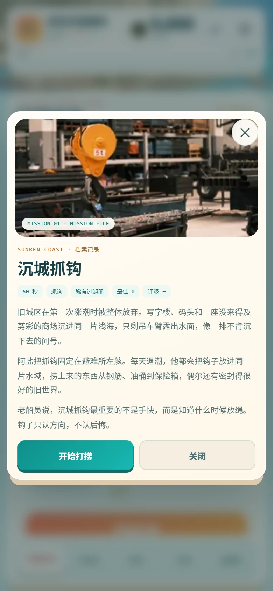

## 任务轮换

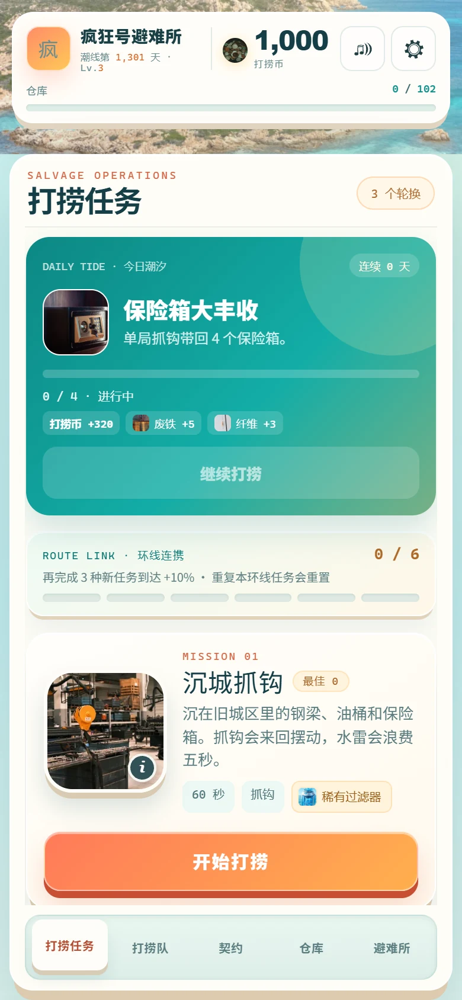

- 打捞任务页同时只展示 **3 个主动任务**。
- 其余 8 个任务留在后台候补队列，不在页面底部展开。
- 完成任意主动任务后自动轮换：
  - 该任务回到候补队尾；
  - 队首候补补入主动位。
- 任务卡上不显示「轮换」按钮，页面底部也不显示「探索」入口。
- 收藏追踪的来源任务如果正在后台候补，点击来源时会先自动换上再打开。
- 结算页只保留「返回避难所」，不再提供「再来一局」。
- 收益平衡 v7.19：全任务打捞币结算下调 20%；拖网 / 潜航再降至 50%，吊装 70%，炮击 65%。
- 每局额外收藏从“保底 1 件 + 35% 概率第二件”提高为“保底 1 件 + 65% 概率第二件”。
- 分解产量下调约 20%，材料更依赖长期拆解。

## 环线连携

任务页新增 **ROUTE LINK · 环线连携** 进度卡：

- 连续完成 **3 种不同任务**：打捞币 +10%。
- 连续完成 **6 种不同任务**：打捞币 +20%。
- 重复任何已在本环线里的任务，都会把环线重置为 1。
- 结算页显示「环线 · N/6」，连携奖励直接计入本局打捞币。
- 只影响打捞币，不放大材料，也不会绕过仓库容量。
- 没有离线进度，不新增标签页。

## 任务评级

每个任务按单局成绩给出 **S / A / B / C**：

- 评级只看本局成绩，不受仓库/货币影响。
- 每个任务只保存历史最佳评级，低分不会把 S 降回 A。
- 任务卡会显示最佳评级徽章；结算页显示本局评级。
- 每个任务**首次拿到 S** 时一次性奖励 **+300 打捞币**，之后不重复发放。
- 新增「第一枚 S」与「六项全能 S」两个长期成就。
- 不产生离线收益，也不会增加新标签页。

## 自由集市

「仓库」标签内新增第三个子视图 **集市**，不增加顶层标签。

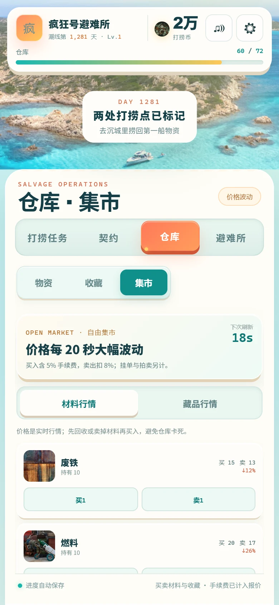

### 波动行情

- 材料与藏品价格每 **20 秒**刷新一次。
- 价格由本地时间确定性计算，波动幅度大，并显示相对上一轮的涨跌。
- 买入报价含 **5%** 手续费，卖出报价已扣 **5%** 手续费；基础价整体上调。
- 买入价高于卖出价，叠加手续费后无法在同一轮左右倒手套利。
- **物资匮乏**：每买入 1 件同种材料，本 60 秒窗口内该材料再买贵 **25%**，最多累计 +300%。
- 窗口刷新后匮乏压力重置；卖出价不受匮乏影响。
- 价格变化不产生离线收益；关闭页面不会自动成交。

### 藏品货架

- 藏品页每 **20 秒**只展示 **6 种**可买藏品。
- 货架由本地时间确定性生成，同一窗口内刷新页面不变。
- 窗口切换后自动换一批，营造物资匮乏与寻货感。
- 「我的收藏」列出全部已拥有普通收藏，**卖出不受六件货架限制**。
- 任意已拥有藏品可直接「卖1」，也可对货架上的藏品挂单 / 拍卖。
- **海水过滤器可以卖出，但不能买入**：它不会出现在六件货架，只出现在「我的收藏」卖出区。
- 过滤器按独立行情基准 3,200 结算，卖出扣 5% 手续费。
- 卖出后立即释放藏品室容量。

### 买卖

- 材料：买 1 / 卖 1；买入受仓库容量限制。
- 藏品：买 1 直接进入收藏档案。
- 海水过滤器不进入集市。

### 码头急单

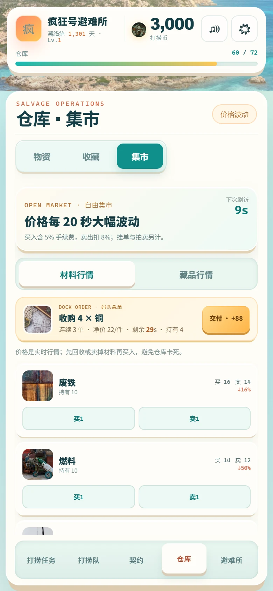

- 集市顶部每 **60 秒**出现一笔限时急单，每 3 个行情周期刷新。
- 急单随机收购：
  - 3–6 件某种材料；
  - 或 1 件普通藏品。
- 急单净价 **高于普通卖出、低于直接买入**，避免低买高卖套利。
- 显示物品、数量、单价、剩余秒数与当前持有。
- 数量不足时按钮显示「数量不足」；交付后立即结算，按钮变为「已交付」。
- 藏品被急单取走后，如果是最后一件会自动卸下。
- 同一时间窗口只能交付一次；刷新后出现新单。
- **连续急单**：相邻窗口连续交付会提高净价，横幅显示「连续 N 单」。
- 连击加成有硬上限，单价最多为当前行情 ×1.04，仍低于买入价 ×1.05，不能低买高卖。
- 错过窗口后连击归零。
- 不产生离线收益。

### 挂单出售

- 对已拥有的藏品选择「挂单」。
- 四档定价：快速出手 / 随行就市 / 小幅溢价 / 愿者上钩。
- 支付 **4% 挂牌费**，经过一段撮合动画后按概率成交。
- 成交再扣 **8%** 交易费；流拍时藏品退回，挂牌费不退。

### 实时拍卖

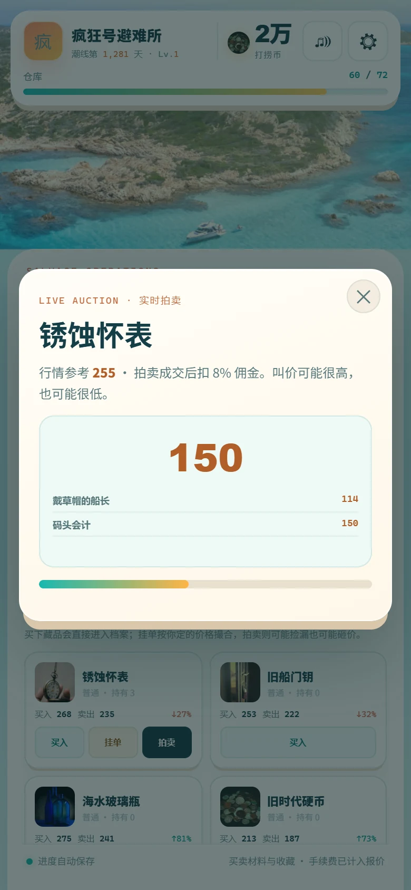

- 对已拥有的藏品选择「拍卖」。
- 经过 4 轮叫价过场动画后落槌。
- 成交价随机，约为行情价的 **0.35–2.1 倍**，可能捡漏也可能砸价。
- 成交后扣 **8%** 佣金，其余进入打捞币。
- 拍卖期间关闭按钮锁定，避免误触。

## 打捞队

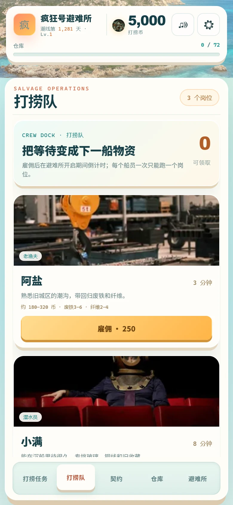

导航新增 **打捞队** 岗位页，不再把所有内容塞进一条长列表。

| 船员 | 岗位 | 时长 | 雇佣费 | 带回 |
| --- | --- | ---: | ---: | --- |
| 阿盐 | 老渔夫 | 3 分钟 | 250 | 打捞币 + 废铁 / 纤维 |
| 小满 | 潜水员 | 8 分钟 | 700 | 玻璃 / 铜 / 芯片，45% 概率带收藏 |
| 老陈 | 声呐员 | 15 分钟 | 1,500 | 打捞币 / 芯片 / 燃料，10% 概率带过滤器 |
| 阿岚 | 海图师 | 20 分钟 | 2,600 | 稀有收藏概率 65%，需避难所 Lv.3 |
| 老周 | 打捞长 | 35 分钟 | 5,200 | 大量物资，18% 过滤器，需避难所 Lv.5 |

- 雇佣后倒计时，完成即可领取。
- **作业只在避难所开启时推进**，关闭页面会暂停；不产生离线收益。
- 每个船员一次只能跑一个岗位，不会自动续雇。
- 收获进入仓库并受容量限制；仓库满时按材料价折算。
- 有可领取岗位时，打捞队导航显示圆点。
- **熟练度**：每完成 1 次作业 +1 熟练度；Lv.2/3/4/5 分别在 1/3/6/10 次时解锁。
- 每提升 1 级：作业时长 -6%，产出 +8%，稀有收藏/过滤器概率 +2 个百分点。
- 船员卡显示等级、熟练度进度与当前产出加成；新增「独当一面」「传奇船队」成就。
- **船员工具**：每名船员有自己的专属工具，Lv.0–3。
  - 每级：产出 +8%，作业时长 -4%，稀有概率 +1 个百分点。
  - 升级消耗打捞币与材料，在船员卡内展开「改装」面板操作。
  - 工具等级与熟练度独立叠加；Lv.3 工具满级。
  - 例如阿盐的潮汐钩、小满的深潜服、老陈的声呐仪、阿岚的海图仪、老周的打捞绞盘。

### 联合远征

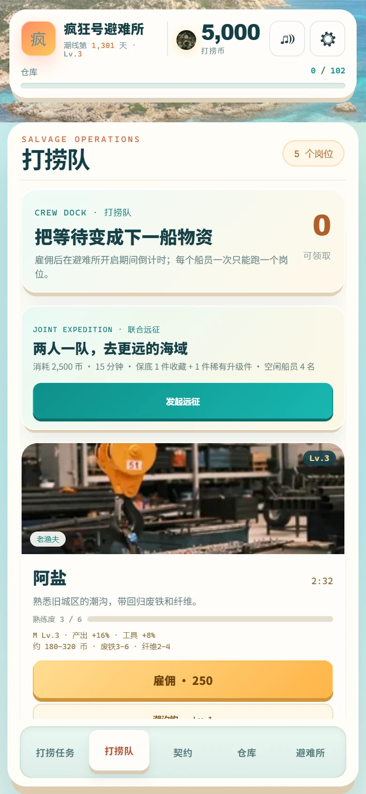

- 避难所 **Lv.3** 解锁，自动挑选 2 名空闲船员。
- 消耗 **2,500 打捞币**，持续 **15 分钟**。
- 远征期间两名船员不能单独出勤。
- 返航奖励随成员熟练度与工具等级提高，并保底：
  - 1 件随机收藏；
  - 1 件稀有升级件。
- 同一时间只能有一队远征。
- 倒计时只在避难所开启时推进；关闭页面暂停，不产生离线收益。
- 可领取时计入「打捞队」导航圆点。
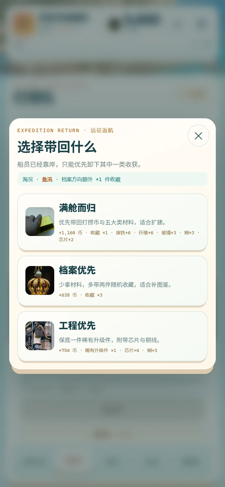

- **返航三选一**：远征完成后选择优先带回什么。
  - **满舱而归**：较多打捞币 + 五类材料 + 1 件收藏；
  - **档案优先**：约 55% 打捞币 + 2 件随机收藏；
  - **工程优先**：约 65% 打捞币 + 芯片/铜 + 保底 1 件稀有升级件。
- 奖励随两名成员的熟练度与工具等级提高；关闭选择窗口不会丢失远征。
- **远征海况**：每次出发随机一种，返航选择界面会显示。
  - 平静海面：标准航程与收益；
  - 顺风：航程缩短 20%；
  - 鱼汛：档案方向额外 +1 件收藏；
  - 寒流：工程方向芯片 / 铜翻倍；
  - 风暴：所有打捞币 +25%，航程 +10%。

## 打捞契约

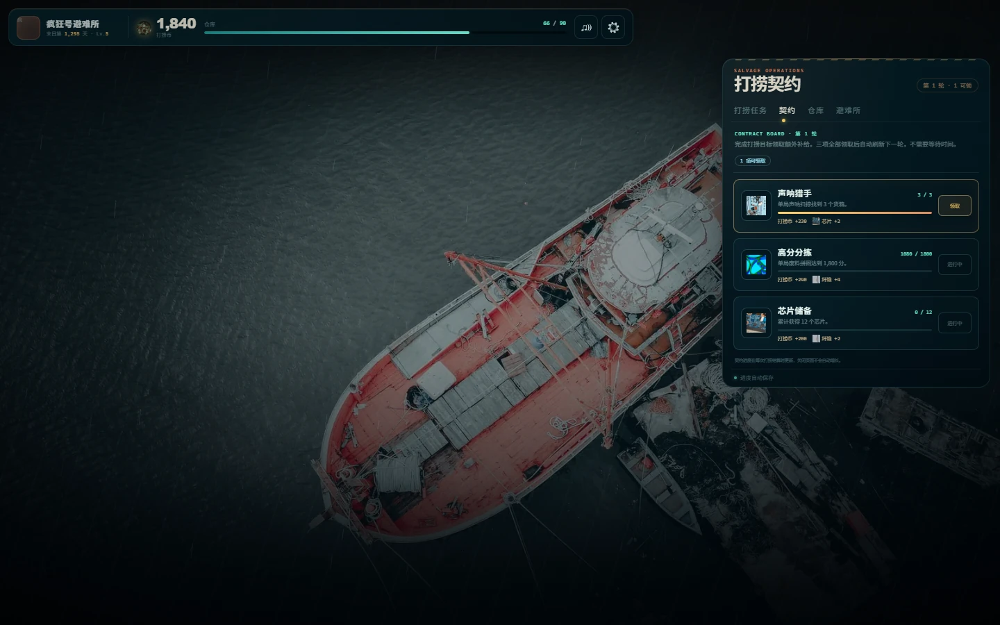

### 本周航线

契约页顶部新增每周目标：

| 目标 | 内容 | 奖励 |
| --- | --- | --- |
| 本周出航 | 完成 6 次打捞 | 600 币 + 燃料 4 |
| 本周收藏 | 带回 8 件收藏 | 800 币 + 芯片 4 + 玻璃 4 |
| 航线覆盖 | 完成 4 种不同任务 | 1,200 币 + 废铁 8 + 铜 4 + 过滤器 1 |

- 三项独立领取；
- 每周按本地日期重置；
- 不同任务按类型去重；
- 契约标签红点包含本周可领目标；
- 不产生离线收益。

每个存档有 **3 个契约**，从保险箱、连击、三消分数、声呐发现、切割切口、分拣件数、灯塔信号、芯片、玻璃、铜、金条、拖网 / 潜航 / 吊装完成次数和总完成次数等目标中随机抽取：

- 完成一局打捞后自动更新进度；**没有离线进度**。
- 进度达标后可领取 **打捞币 + 补给材料**，奖励同样受仓库容量影响。
- 约 **22%** 的轮次会出现 1 个**稀有悬赏**：全图回收或风暴猎手，目标更难、奖励更高。
- 每轮可以花 **80 打捞币**刷新一次未领取契约；已领取的契约会保留。
- 三项全部领取后自动刷新下一轮，并额外获得 **120 打捞币 + 材料**全清奖励。
- 契约图标、进度条、稀有标记和奖励都直接显示在「契约」标签里。

## 海况词条

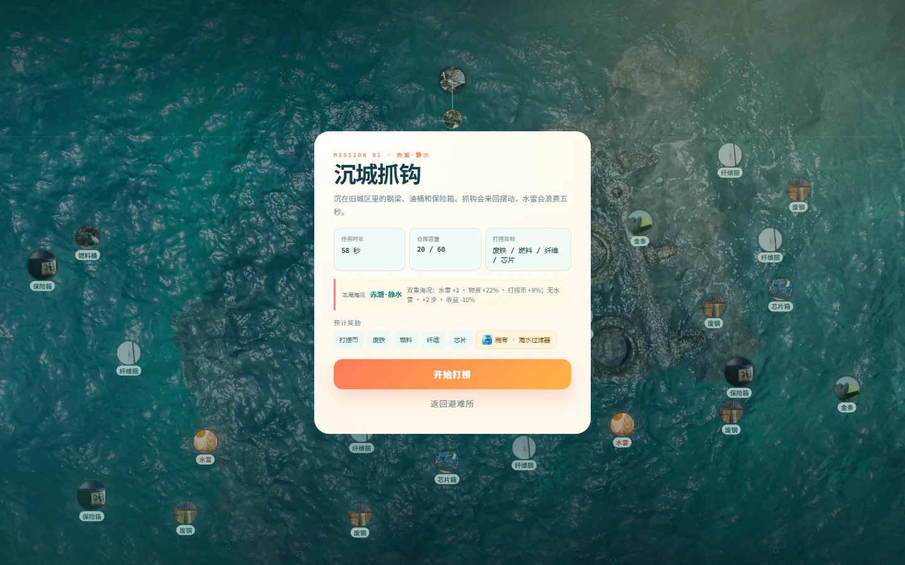

每次出发会随机一种海况；约 **30%** 的航次会出现**双重海况**，同一局里七个小游戏都受影响：

| 海况 | 效果 |
| --- | --- |
| 静水 | 抓钩没有水雷；三消 +2 步；声呐 +1 次；全收益 -10% |
| 雷区 | 抓钩额外 3 颗水雷；三消 -2 步；声呐 -1 次；打捞币 +30% |
| 富氧 | 抓钩 +2 秒；三消 +3 步；声呐 +1 次；全收益 -8% |
| 油污 | 抓钩回收 -12%；三消 -1 步；声呐 -1 次；物资 +18% |
| 赤潮 | 水雷 +1；抓钩 -2 秒；三消 +1 步；物资 +22%；打捞币 +8% |
| 顺风 | 抓钩 +3 秒；三消 +2 步；声呐 +1 次；全收益 -6% |

- 双重海况会同时叠加两个词条的数值，例如「雷区·赤潮」水雷更多、物资更高。
- 任务简报和 HUD 顶部会显示本局海况/组合词条。
- 结算页会保留海况标签，方便对照收益。
- 海况会随每次出发重新抽取，包括结算后的「再来一局」。

## 出航许可

任务简报里会随机给出 **2 张出航许可**，可以二选一，也可以直接跳过：

| 许可 | 效果 |
| --- | --- |
| 稳潮 | +8 秒 / +3 步 / +2 声呐；全收益 -8% |
| 高价 | 打捞币 +25%；-5 秒 / -2 步 / -2 声呐 |
| 满载 | 物资 +25%；-4 秒 / -2 步 / -2 声呐 |

- 许可只影响本局，不写入存档，也不会永久叠加。
- 简报里的时长/步数/声呐次数会实时更新。
- 结算页保留「许可」标签；「再来一局」会回到带新许可的简报。
- 没有离线收益，也不消耗任何货币。

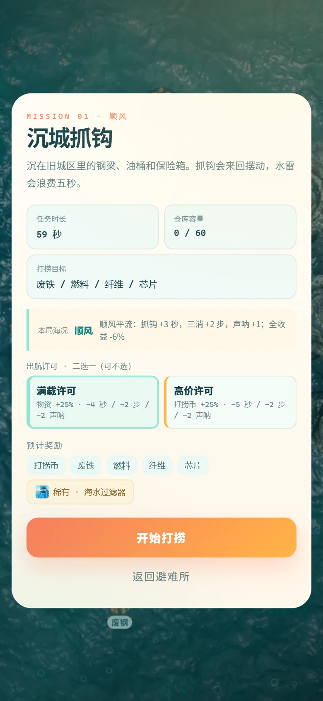

## 沉船收藏与合成

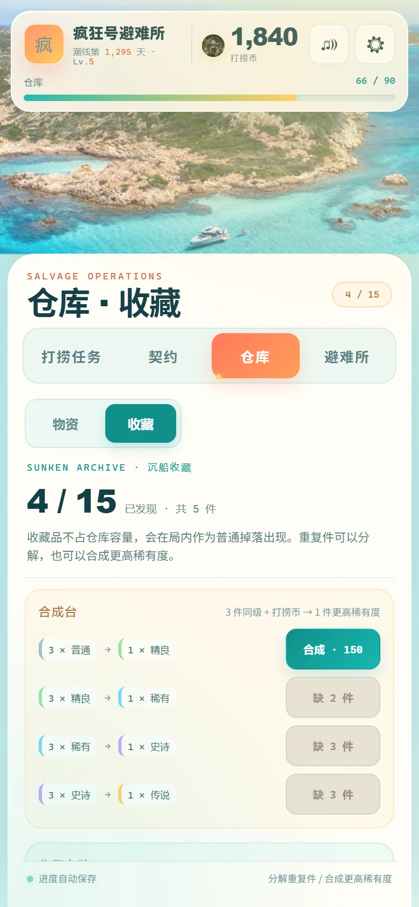

仓库与收藏已经合并：进入「仓库」后，用顶部的 **物资 / 收藏** 切换。收藏区包含 102 件沉船档案（98 件打捞物 + 海水过滤器 + 3 件稀有升级件），每件都有独立的本地图片，按 5 个稀有度划分：

| 稀有度 | 件数 | 示例 |
| --- | ---: | --- |
| 普通 | 35 | 锈蚀怀表、防水火柴盒、玻璃浮球 |
| 精良 | 27 | 铜制气压计、旧港邮票册、船用灯泡 |
| 稀有 | 19 | 船用六分仪、旧式电报键、脚踏缝纫机 |
| 史诗 | 12 | 老式收音机、深海录音带、船长航海日志 |
| 传说 | 9 | 潮汐罗盘、月光珊瑚、电鳗发电机、黄金大炮、海水过滤器 |

两件新增传说收藏：

- **电鳗发电机**：铜壳里养着一条电鳗，档案效果为抓钩 +5 秒、声呐 +2 次。
- **黄金大炮**：沉船金条熔铸的礼炮，档案效果为全收益 +8%。

它们与「船长佩剑」组成 **黄金舰队** 套装。

- 收藏品与消耗品**同级**，直接进入原有掉落表，不再额外刷特殊物件：
  - 抓钩：普通海床物品槽约 5% 直接生成收藏品，抓回即可。
  - 三消：每盘固定混入 3 个收藏品方块，和废料方块一样消除获得。
  - 声呐：每个普通货箱约 15% 直接是收藏品，找到货箱即获得。
- 所有打捞局改为**藏品优先**：结算不再直接入库材料，每局至少带回 1 件收藏，35% 概率额外 1 件；材料需分解藏品获得。
- 收藏品**不占仓库容量**，但占用**藏品室容量**；基础 40 格，可在避难所扩建「藏品室」，每级 +12，满级 112。
- 容量满时新收藏会折算成打捞币；分解 / 拍卖会释放容量。
- 每件藏品都有独立的**出航加成**，最多装备 3 件。
- 例如锈蚀怀表 +2 秒、旧船门钥声呐 +1 次、海水玻璃瓶物资 +2%、潮汐王冠全收益 +8% 且三项次数都增加。
- 装备的加成直接计入抓钩时长、三消步数、声呐次数和结算倍率，与套装/海况/许可叠加。
- 重复件可以**拍卖**、分解或合成；被消耗掉的藏品会自动卸下。
- **海水过滤器**也收录在收藏档案中，但仍是净水舱的升级材料，不参与拍卖。
- 新增 3 件**稀有升级件**：声呐核心、耐压阀、潮汐电池。它们不参与拍卖 / 分解 / 合成，是避难所 Lv.3/4/5 的必需材料。
- 升级件主要来自抓钩的沉船秘宝 / 黄金宝箱，以及三消高分的深海馈赠。

### 收藏详情

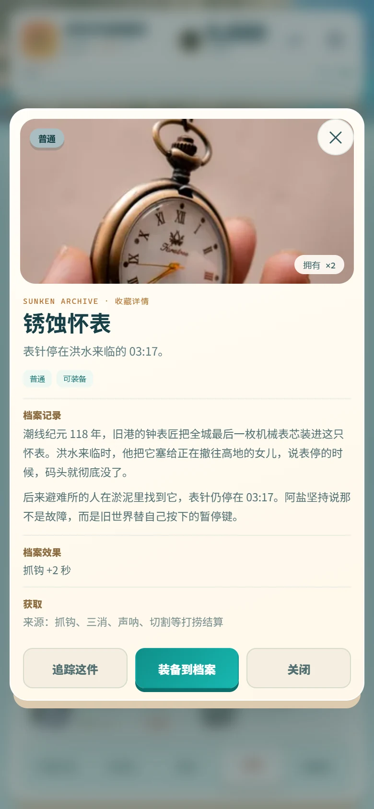

- **收藏页只展示已经拥有的藏品**；未发现内容不再铺在列表中。
- 点击收藏卡，或图片右下角 `i` 按钮，都能打开详情。
- 详情展示：大图、稀有度、拥有数量、描述、**两段架空世界档案记录**、套装进度、档案效果、升级用途、获取来源。
- 已拥有的普通收藏可直接在详情里装备 / 卸下；升级件只显示用途，不提供装备。
- 卡片内的「装备 / 分解」按钮仍独立可点，不会误触详情。
- 102 件收藏各有独立背景故事，详情弹窗会完整展示两段档案记录。
- 收藏图片已按用户提供的工作簿逐件替换为 `assets/collectibles/unique-v2/<id>.webp`。
- 101 件工作簿图片转为 480×480 WebP；海水过滤器使用用户原图；102 张哈希全部不同。

### 搜索、筛选与分页

收藏页顶部提供：

- 名称搜索框；
- 稀有度筛选：全部 / 普通 / 精良 / 稀有 / 史诗 / 传说；
- 原有「全部 / 已拥有 / 套装 / 升级件」筛选；
- 每页 24 件，底部显示页码与总数。

筛选条件可叠加；切换条件会回到第 1 页。

### 藏品室容量

- 普通收藏计入容量；海水过滤器与 3 件稀有升级件不计入。
- 基础容量 **40**。
- 「藏品室」每级 +12，最高 6 级，总容量 **112**。
- 已满时：
  - 新收藏折算打捞币；
  - 集市购买暂停；
  - 船员 / 远征收藏同样受限。
- 分解、批量分解、拍卖会腾出空间。
- 旧存档超过容量的部分会保留，不会强制删除。


### 收藏追踪

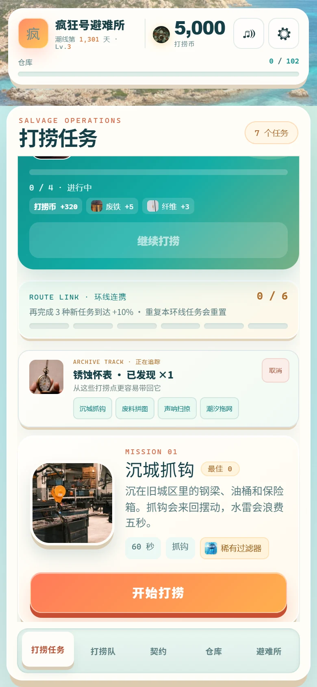

- 在收藏详情里点击「追踪这件」。
- 任务页顶部出现追踪卡：
  - 目标名称；
  - 已有数量；
  - 可产出它的打捞点。
- 点击来源按钮直接打开对应小游戏简报：
  - 普通收藏：抓钩 / 三消 / 声呐 / 拖网；
  - 稀有升级件：抓钩 / 三消；
  - 海水过滤器：抓钩 / 声呐。
- 收藏卡显示「追踪」角标和青色描边。
- 再次点击详情内「取消追踪」可移除。

### 筛选与图鉴里程碑

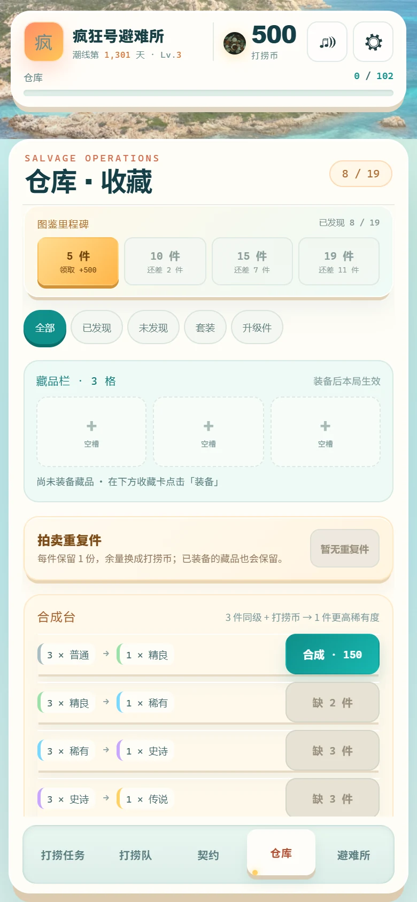

- 收藏页顶部筛选：
  - 全部 / 已拥有 / 套装 / 升级件；
  - 筛选后空稀有度分组自动隐藏；
  - 无结果时显示空状态；尚未拥有任何藏品时提示去打捞。
- 图鉴里程碑：

| 已发现 | 奖励 |
| ---: | --- |
| 5 件 | 500 打捞币 + 废铁 5 + 纤维 5 |
| 10 件 | 1,500 打捞币 + 玻璃 6 + 芯片 6 |
| 25 件 | 4,000 打捞币 + 铜 10 + 芯片 10 |
| 50 件 | 9,000 打捞币 + 玻璃 16 + 芯片 16 + 铜 12 |
| 75 件 | 18,000 打捞币 + 玻璃 24 + 芯片 24 + 铜 20 + 过滤器 1 |
| 102 件 | 40,000 打捞币 + 六种材料各 40 + 过滤器 2 |

- 里程碑手动领取，只按不同收藏计数，重复件不重复计数。
- 领取记录写入存档，不会重复发放。

### 拍卖重复件

- 收藏页顶部有「拍卖重复件」按钮。
- 每件藏品保留 1 份，只出售多余重复件。
- 价格按稀有度：普通 180 / 精良 450 / 稀有 1,100 / 史诗 2,600 / 传说 6,000 打捞币。
- 拍卖所得直接进入打捞币，不占仓库；已装备的藏品至少保留 1 份。
- 海水过滤器不参与拍卖，只作为净水舱材料。

### 藏品补料

- 当扩建材料不足、而仓库里还有重复收藏时，扩建卡会出现「藏品补料」。
- 点击后拆解 1 件最低稀有度的重复收藏，产出的材料**直接补入仓库**（不受容量上限拦截）。
- 每件藏品仍保留 1 份；可连续点击，直到材料足够。
- 这是仓库已满、又缺特定升级材料时的兜底路径。

### 藏品栏

- 在「仓库 → 收藏」顶部选择 3 件已拥有的藏品装备。
- 不消耗藏品本体，可以随时卸下或替换。
- 装备 3 件后，收藏卡、藏品栏和本局属性都会同步变化。
- 没有离线收益，也不需要等待时间。

### 分解

- 局内不再直接产出仓库物资，**物资主要来源是分解藏品**：

| 稀有度 | 分解产出 |
| --- | --- |
| 普通 | 废铁 +2 · 纤维 +2 |
| 精良 | 废铁 +3 · 芯片 +2 · 玻璃 +2 |
| 稀有 | 废铁 +5 · 燃料 +2 · 芯片 +2 · 玻璃 +2 · 铜 +2 |
| 史诗 | 废铁 +8 · 燃料 +3 · 纤维 +3 · 芯片 +4 · 玻璃 +3 · 铜 +3 |
| 传说 | 废铁 +13 · 燃料 +5 · 纤维 +5 · 芯片 +6 · 玻璃 +5 · 铜 +5 |

- 收藏页「处理重复件」可一键**分解全部重复件**：每件保留 1 份，汇总材料入库；与「拍卖重复件」并列，拍卖换币、分解换材料。
- 合成台规则：**3 件同稀有度 + 打捞币 → 1 件下一稀有度**。

| 合成 | 打捞币 |
| --- | ---: |
| 3 普通 → 1 精良 | 150 |
| 3 精良 → 1 稀有 | 400 |
| 3 稀有 → 1 史诗 | 1,000 |
| 3 史诗 → 1 传说 | 2,500 |

### 收藏套装

集齐指定藏品后，永久获得加成，不需要手动领取：

| 套装 | 组成 | 永久加成 |
| --- | --- | --- |
| 航海官 | 黄铜罗盘 + 航线图筒 + 铜制望远镜 | 打捞币 +10% |
| 深潜者 | 旧式留声机 + 深海潜水盔 + 沉船船钟 | 物资 +10% |
| 船长遗物 | 船长航海日志 + 黑匣子 + 潮汐王冠 | 打捞币 +10% · 物资 +10% |
| 旧港务局 | 铜制气压计 + 旧港邮票册 + 航海信号旗 + 保险柜铭牌 | 打捞币 +8% · 物资 +8% |
| 潮汐研究站 | 老式收音机 + 深海录音带 + 潮汐罗盘 + 月光珊瑚 | 打捞币 +12% · 物资 +12% |
| 黄金舰队 | 电鳗发电机 + 黄金大炮 + 船长佩剑 | 打捞币 +15% · 物资 +15% |

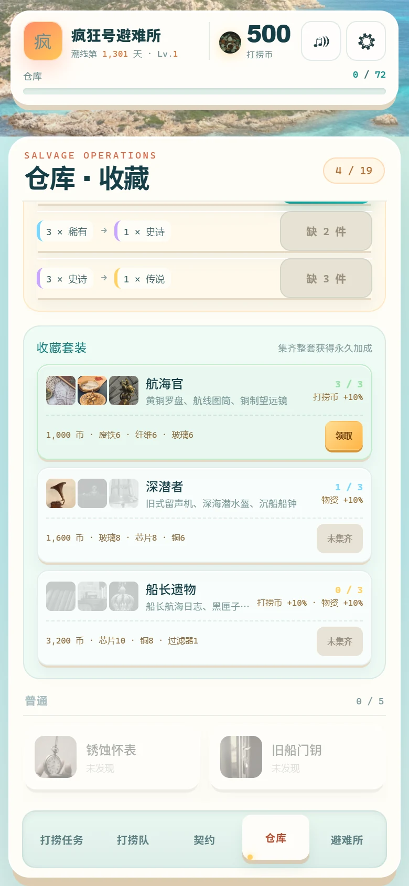

套装完成后还可领取**一次性奖励**：

| 套装 | 完成奖励 |
| --- | --- |
| 航海官 | 1,000 打捞币 + 废铁 6 + 纤维 6 + 玻璃 6 |
| 深潜者 | 1,600 打捞币 + 玻璃 8 + 芯片 8 + 铜 6 |
| 船长遗物 | 3,200 打捞币 + 芯片 10 + 铜 8 + 过滤器 1 |
| 旧港务局 | 2,600 打捞币 + 废铁 8 + 玻璃 8 + 纤维 8 |
| 潮汐研究站 | 4,800 打捞币 + 芯片 12 + 铜 10 + 玻璃 8 + 过滤器 1 |
| 黄金舰队 | 9,000 打捞币 + 芯片 18 + 铜 16 + 玻璃 12 + 过滤器 1 |

- 完成奖励在套装卡内手动领取，只发一次。
- 未集齐时按钮显示「未集齐」，已领取显示「已领取」。
- 套装与工坊、声呐、净水舱倍率叠加。
- 收藏品与过滤器、仓库、海况互不冲突。
- 仓库容量卡片新增「回收 10 件物资」：从数量最多的材料开始出售，用于腾出空间再出航。
- 「契约」中新增「沉船收藏家」目标。
- 收藏贴图全部来自 **Pexels 写实照片**（非线稿图标），已下载为本地 360×360 WebP，不从远程加载。

## 稀有打捞物 · 海水过滤器

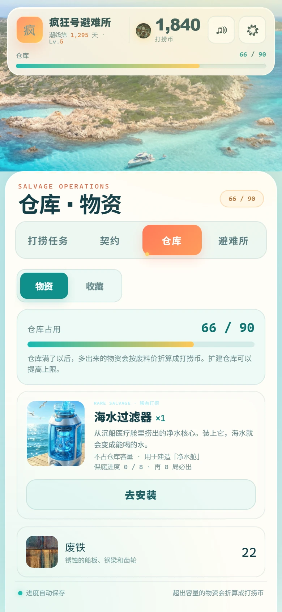

这台银蓝色的密封装置是沉船医疗舱里最值钱的东西：**不占仓库容量，只能用打捞行为获得，而且相当稀有。**

- **沉城抓钩**：约有 **12%** 的航次会在废墟中生成一台过滤器。它不会自己进仓，必须主动抓回来；错过就没有了。
- **废料拼图**：单局达到 **1,200 分** 后，约有 **5%** 概率从废料夹层里翻出一台。
- **声呐扫掠**：每次出发约有 **8%** 概率让一个货箱变成过滤器。
- **8 局保底**：连续 8 次完成打捞都没有获得过滤器时，下一局必定出现（抓钩强制生成 / 三消必定翻出 / 声呐强制藏入）；仓库稀有卡会显示保底进度。
- 获得后会进入仓库的「稀有打捞」栏，并显示在结算页。
- 用途：在避难所建造 **净水舱**，每级消耗 1 台过滤器。净水舱每级提供 **打捞币收益 +10% · 物资收益 +5%**，最高 3 级。

沉船不会天天有过滤器。看到蓝色密封罐时，先放抓钩。

## 通用货币与避难所仓库

所有任务共享一套经济系统：

- **打捞币**：通用货币，用于所有扩建。
- **废铁 / 燃料 / 纤维 / 芯片 / 玻璃 / 铜**：六种入库材料，用于不同扩建。
- **仓库容量**：初始 72 格，每级仓库扩容 +30 格。
- **溢出规则**：仓库满了以后，多出的材料会自动按废料价折算为打捞币，不会丢失。

| 材料 | 来源倾向 | 溢出折算 |
| --- | --- | --- |
| 废铁 | 抓钩 / 三消 | 8 打捞币 |
| 燃料 | 抓钩 | 10 打捞币 |
| 纤维 | 三消 / 抓钩 | 8 打捞币 |
| 芯片 | 抓钩芯片箱 / 三消 | 16 打捞币 |
| 玻璃 | 抓钩玻璃瓶 / 三消 / 声呐玻璃箱 | 12 打捞币 |
| 铜 | 抓钩铜线圈 / 三消 / 声呐铜线圈 | 14 打捞币 |

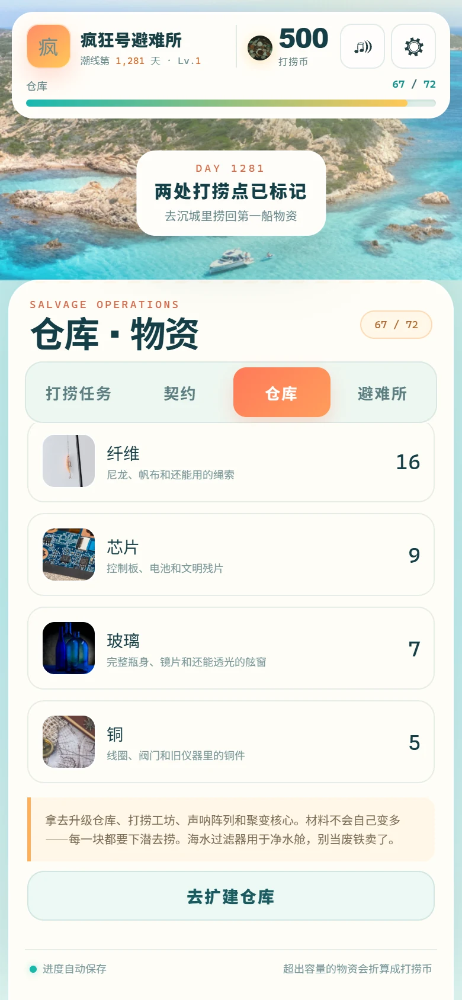

### 避难所等级

HUD 中的 `Lv.` 现在是**避难所等级**（1–5），设施等级在扩建页单独显示。

| 等级 | 收藏加成 | 容量加成 | 解锁 |
| --- | ---: | ---: | --- |
| 1 | +0% | +0 | 基础设施 |
| 2 | +4.5% | +15 | 高级扩建 Lv.6 |
| 3 | +9% | +30 | 船员「阿岚」、更多扩建 |
| 4 | +13.5% | +45 | 高级扩建 Lv.7 |
| 5 | +18% | +60 | 船员「老周」、终极扩建 |

升级条件同时检查：

- 打捞币；
- 六种材料；
- 已收集的不同藏品数量；
- 累计出航次数。

Lv.2 需要 4,000 币 / 20 废铁 / 20 纤维 / 4 件收藏 / 10 次出航；Lv.5 需要 80,000 币、120 件材料、15 件收藏、1 个潮汐电池、1 台过滤器和 100 次出航。

额外升级件要求：

- Lv.3：声呐核心 ×1；
- Lv.4：耐压阀 ×1；
- Lv.5：潮汐电池 ×1 + 海水过滤器 ×1。

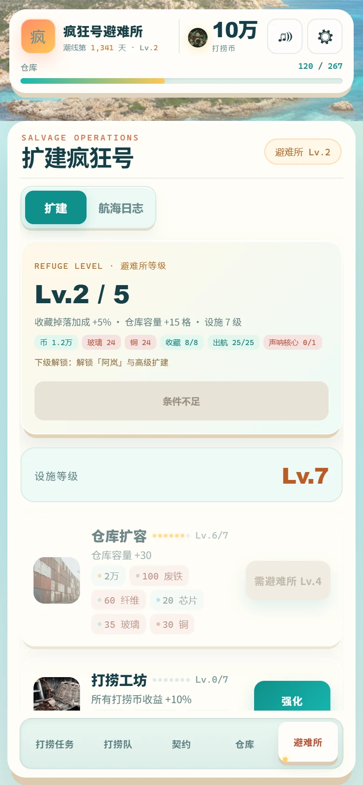

### 当前外观

避难所页顶部新增五个照片模块：

- 驳船甲板；
- 净水舱；
- 声呐桅杆；
- 工作间；
- 潮汐核心。

模块按避难所等级解锁，当前等级高亮，未解锁灰显并标注所需等级。

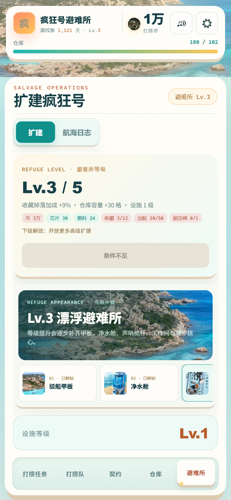

### 可扩建项目

| 项目 | 效果 | 等级 |
| --- | --- | --- |
| 仓库扩容 | 容量 +30 / 级 | 7 |
| 打捞工坊 | 打捞币收益 +10% / 级 | 7 |
| 声呐阵列 | 物资收益 +12% / 级 | 6 |
| 聚变核心 | 抓钩 +5 秒 · 三消 +2 步 | 5 |
| 净水舱 | 打捞币 +10% · 物资 +5% / 级，消耗海水过滤器 | 5 |
| 藏品室 | 收藏品容量 +12 / 级（基础 40） | 6 |
| 电鳗发电机 | 抓钩 +2 秒 · 声呐 +1 次 / 级；需拥有「电鳗发电机」收藏 | 3 |
| 黄金大炮 | 打捞币收益 +5% / 级；需拥有「黄金大炮」收藏 | 3 |

更高设施等级需要相应避难所等级；卡片会直接显示「需避难所 Lv.N」。

电鳗发电机与黄金大炮还需要对应传说收藏作为核心，未拥有时按钮显示「需核心藏品」。

部分高等级设施还会消耗 **稀有 / 史诗 / 传说收藏**：

- 仓库 Lv.7：稀有收藏 ×2；
- 工坊 Lv.6 / 声呐 Lv.5：稀有收藏 ×2；
- 工坊 Lv.7 / 声呐 Lv.6 / 核心 Lv.4：史诗收藏 ×1；
- 核心 Lv.5：史诗收藏 ×2；
- 净水舱 Lv.5：传说收藏 ×1。

已装备的收藏不会被消耗；优先消耗重复件。

仓库、材料、过滤器、收藏、升级和最高成绩都会自动保存在本地。

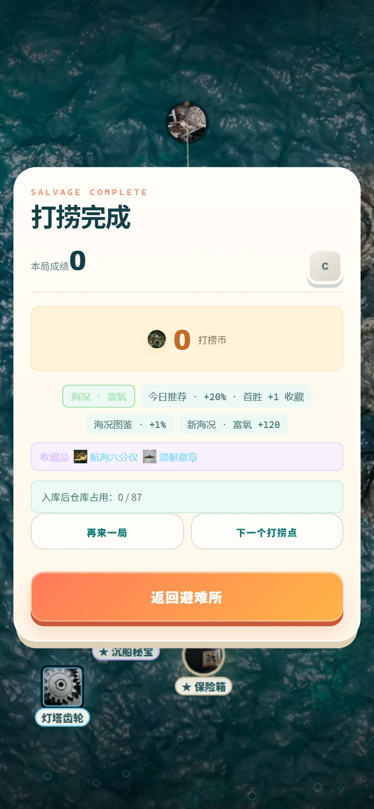

## 收藏图片加载

- 每件收藏使用两张图：
  - 卡片：`assets/collectibles/thumbs/<id>.webp`，128×128；
  - 详情：`assets/collectibles/unique-v2/<id>.webp`，480×480。
- 102 张缩略图总计约 330KB，约为原图体积的 1/6。
- 卡片、套装、市场和追踪图使用缩略图并懒加载；详情打开时才加载大图。
- 海水过滤器直接使用用户提供的原图 `assets/seawater-filter.webp`；卡片缩略图由这张原图裁切。

## 画面质量

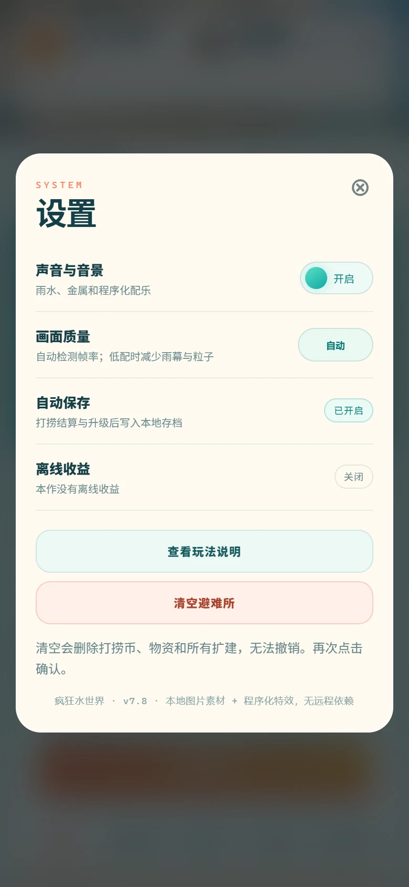

设置里新增 **画面质量**：

- **自动**：每 1.5 秒采样帧率；低于 38fps 自动切省电并提示。
- **高**：完整雨幕、粒子、暗角和 1.5 DPR。
- **省电**：DPR 上限 1.0、雨幕 6–12 条，隐藏颗粒 / 雨窗 / 暗角，小游戏同步降级。

- 画质设置写入存档 `quality`。
- 手动切回高画质会重置自动降级标记。

## 操作

| 操作 | 方式 |
| --- | --- |
| 放下抓钩 | 点击/轻触水面，或点「放下抓钩」 |
| 交换废料箱 | 滑动相邻方块，或依次点两个相邻方块 |
| 发射声呐 | 点击 6×6 海床格子 |
| 暂停/退出任务 | 左上角返回，然后选择继续或放弃 |
| 查看/领取契约 | 打开「契约」标签，达标后点「领取」 |
| 合成/分解收藏 | 打开「仓库 → 收藏」，用 3 件同级收藏合成；重复件点「分解」 |
| 声音 | 右上角声音按钮，或 `M` |
| 开始游戏 | 点击按钮或按 `Enter` |

没有任何摇杆、方向键或复杂连招，手机端单手即可完成全部操作。

## 为什么是末日之后

海平面在 2117 年越过临界点。城市只剩下天线和屋顶，旧世界的物流、货币和秩序一起沉进水里。

「疯狂号」是一座用驳船、集装箱和偷来的聚变核心拼起来的漂浮避难所。它不好看，但还能漂。打捞队每天从沉城里带回一点文明残片，再把它们变成仓库、净水、灯光和下一顿饭。

游戏里的 **末日第 1,281 天** 会随着下潜次数缓慢推进。

## 部署到 GitHub Pages

### 方式 A：GitHub Actions（已自带工作流）

1. 推送仓库，默认分支使用 `main` 或 `master`。
2. 进入 **Settings → Pages**。
3. **Build and deployment → Source** 选择 **GitHub Actions**。
4. workflow `Deploy 疯狂水世界 to GitHub Pages` 会把仓库静态文件原样上传并发布，**没有构建步骤**。

工作流文件：[.github/workflows/pages.yml](.github/workflows/pages.yml)。

### 方式 B：从分支直接发布

1. **Settings → Pages → Source** 选择 **Deploy from a branch**。
2. 选择分支和 `/ (root)`。
3. 保存并等待 Pages 生成站点。

所有路径均为相对路径，放在仓库根目录或 Pages 子路径都能运行；`.nojekyll` 已包含。

## 技术栈

- HTML5 Canvas 2D + 原生 JavaScript，纯静态 HTML/CSS/JS；无 Node、无 npm、无框架、无构建步骤。
- **四首本地 BGM**：标题/避难所 Loop A、抓钩 Loop D、三消 Loop I、声呐 Loop C；场景切换时自动换曲，返回避难所从暂停位置继续。
- **音效扩充**：界面切换、领取契约、合成、分解、声呐 ping / 货箱发现、四连线扫、五连彩虹、连击、错误与稀有物音效均由 Web Audio 实时合成。
- 声音按钮同时控制 BGM 和音效，静音时暂停当前曲目，恢复后从原位置继续。
- 指挥台布局：桌面为左侧导航 + 多列内容网格；手机为顶部状态 + 主内容 + 底部导航，不再使用单一上拉抽屉。任务标题 18–21px、正文 12–13px、主按钮 48–50px 高。
- 手机端 DPR 限制为 1.5、像素预算下调、粒子数量封顶；抓钩/三消继续使用预渲染缓存，减少卡顿。
- **所有游戏插画与物件均为写实照片**：标题、避难所、各类小游戏背景，以及抓钩物品、三消废料、声呐货箱、任务、材料、扩建与收藏，全部使用本地化 Pexels 照片；仅声音/设置/返回/关闭等界面操作图标保留矢量图形。
- 海水过滤器使用你提供的图片，已裁掉左上「AI生成」与右下「千问」水印；它会出现在抓钩水面、任务标签、任务简报、HUD 战利品、仓库稀有卡、净水舱图标、玩法说明和结算页。
- Canvas 现在只负责图片合成、雨、光照、粒子、抓钩物理和棋盘交互。

> 所有图片都是本地文件，不依赖远程图床。来源和授权见 [CREDITS.md](CREDITS.md)。

## 项目结构

```text
.
├── index.html                  # 页面骨架、HUD、指挥台、小游戏外壳
├── css/style.css               # 末日海景视觉、响应式布局、游戏界面
├── js/
│   ├── audio.js                # 本地 BGM + Web Audio 音景与音效
│   ├── collectibles.js         # 102 件收藏档案、稀有度、升级件与合成配方
│   ├── hub.js                  # 存档、货币、仓库、过滤器、收藏、扩建
│   ├── hub-scene.js            # 照片背景合成、雨、光照与暗角
│   ├── arcade.js               # 小游戏外壳 + 沉城抓钩 + 海况
│   ├── match.js                # 废料拼图（三消）
│   ├── sonar.js                # 声呐扫掠（6×6 推理解谜）
│   ├── expeditions.js          # 沉船切割 / 分拣传送带 / 灯塔信号
│   ├── trawl.js                # 潮汐拖网（接落物）
│   ├── dive.js                 # 深海潜航（自由移动收集）
│   ├── stack.js                # 码头吊装（堆叠货箱）
│   ├── gunnery.js              # 黄金炮击（瞄准射击）
│   └── trench.js               # 海沟回声（洞穴闪避）
├── assets/
│   ├── bg-title.webp             # 标题：热带海湾航拍
│   ├── bg-hub.webp               # 避难所：浅湾游艇
│   ├── bg-hook.webp              # 抓钩：清澈浅海沉船
│   ├── bg-match.webp             # 三消：阳光工坊
│   ├── bg-sonar.webp             # 声呐：木质船舵
│   ├── bgm-hub.mp3               # 标题 / 避难所
│   ├── bgm-floodline.mp3         # 沉城抓钩
│   ├── bgm-match.mp3             # 废料拼图
│   ├── bgm-sonar.mp3             # 声呐扫掠
│   ├── real/                     # 抓钩 / 三消 / 声呐 / 材料 / 扩建写实照片
│   ├── icons/                    # 仅声音 / 设置 / 返回 / 关闭界面图标
│   ├── collectibles/             # 打捞收藏与特殊升级件档案（Pexels）
│   ├── seawater-filter.webp      # 用户提供的过滤器图（已裁掉水印）
│   └── seawater-filter-icon.webp # 方图，用于抓钩 / 标签 / 图标
├── favicon.png                   # 过滤器图片裁切
├── CREDITS.md                    # 图片、图标与 BGM 来源
├── .nojekyll                     # GitHub Pages 原样发布静态文件
├── docs/                         # README 预览图（WebP）
├── DESIGN.md                   # 详细游戏设计文档
├── ROADMAP.md                  # 两小时迭代路线与候选玩法
└── .github/workflows/pages.yml
```

## 存档

- `crazywater.floodline.v1`：打捞币、材料、海水过滤器、扩建、最高分、下潜次数。
- `crazywater.muted.v1`：声音开关。
- 没有离线收益字段，也没有离线结算逻辑。

清空存档：打开设置，点击两次「清空避难所」；或在开发者工具中执行：

```js
localStorage.removeItem('crazywater.floodline.v1');
location.reload();
```

## 自定义

- 奖励与升级数值：`js/hub.js` 顶部的 `MATERIALS` / `UPGRADES` / 任务生成。
- 抓钩物品、过滤器出现率、时长与物理：`js/arcade.js` 的 `ITEM_TYPES` / `chance(0.12)` / `HookGame`。
- 三消棋盘、过滤器掉落、步数与奖励：`js/match.js` 的 `TILES` / `chance(0.05)` / `MatchGame`。
- 末日海景和避难所：`js/hub-scene.js`。
- 过滤器图片：`assets/seawater-filter.webp`（仓库卡 / 文档）和 `assets/seawater-filter-icon.webp`（水面 / 标签 / 图标）。
- 场景与物件：替换 `assets/bg-*.webp`、`assets/real/*.webp` 或 `assets/collectibles/*.webp` 即可整体换皮。
- 素材来源与授权：[CREDITS.md](CREDITS.md)。
- 色彩与排版：`css/style.css` 顶部变量。
- 音效与 BGM：`js/audio.js`。

更完整的设计说明见 [DESIGN.md](DESIGN.md)。  
后续两小时迭代计划和候选玩法见 [ROADMAP.md](ROADMAP.md)。

## License

[MIT](LICENSE) · 把这座疯狂号改成你自己的避难所。
